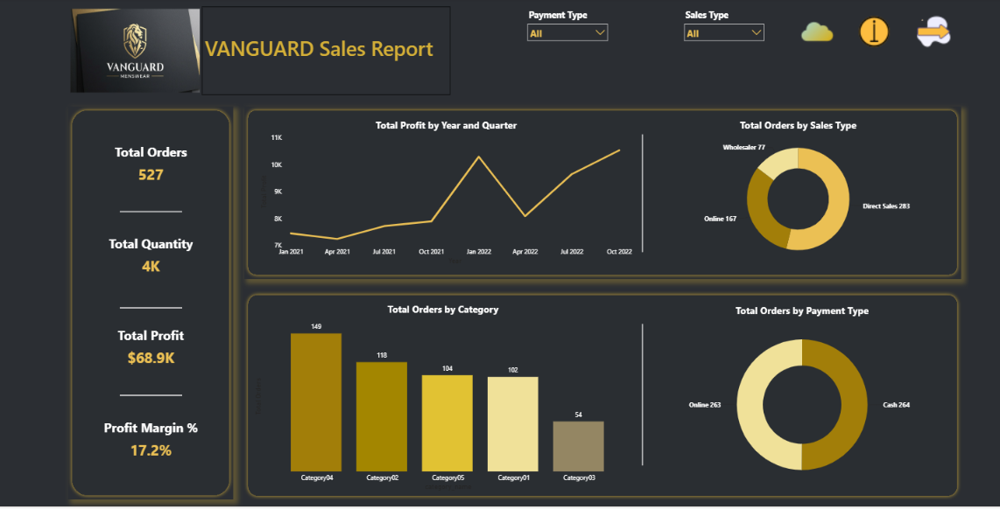
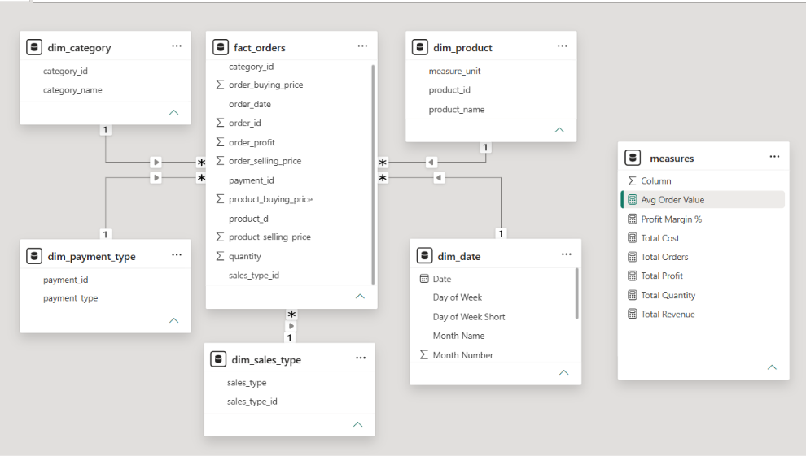
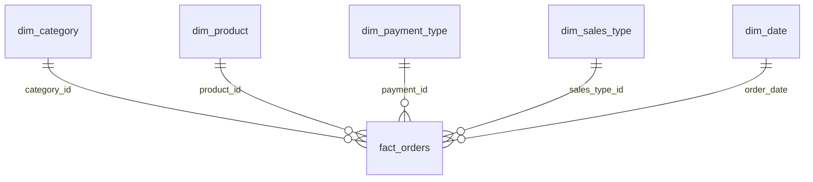
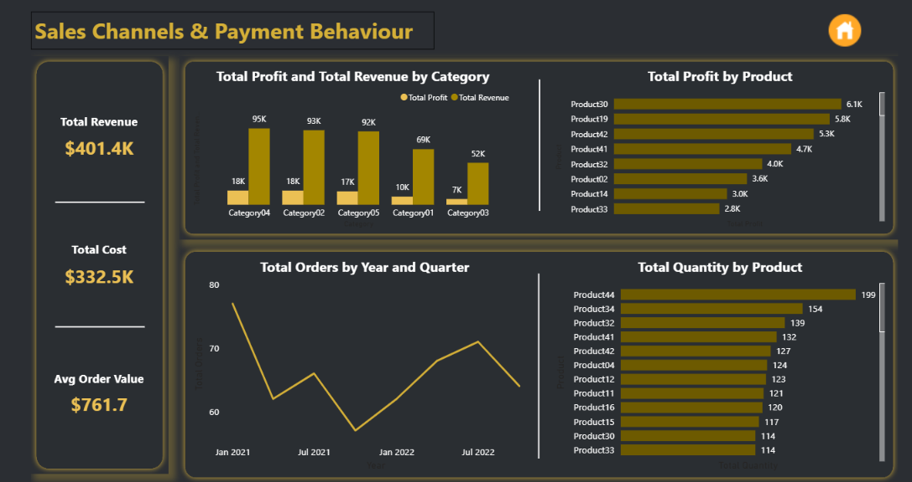

# 🛍️ VANGUARD Sales Report | Power BI Dashboard

An interactive Power BI dashboard for **VANGUARD Menswear** that turns raw order data into clear answers about **sales volume, purchasing channels, payment behaviour, category and product performance, and profitability**.




---

## 📑 Table of Contents

- [Project Overview](#-project-overview)
- [Business Questions & Answers](#-business-questions--answers)
- [Data Model](#-data-model)
- [Data Preparation](#-data-preparation)
- [Key Measures](#-key-measures)
- [Dashboard Pages](#-dashboard-pages)
- [Key Insights](#-key-insights)
- [Recommendations](#-recommendations)
- [Tools & Techniques](#-tools--techniques)
- [Repository Structure](#-repository-structure)
- [How to Use](#-how-to-use)
- [Author](#-author)

---

## 🎯 Project Overview

The dataset records store transactions made through different **sales types** (online, wholesaler, and direct sales), paid by different **payment methods** (online or cash), with product details such as product, price, and quantity.

This project imports the data into Power BI, cleans and models it, and builds a branded dark and gold dashboard so the store owner can see at a glance:

- How many orders the store gets and how much profit it makes
- Which sales channel and payment method customers prefer
- Which categories and products drive orders, revenue, and profit
- How orders and profit have changed over time

---

## ❓ Business Questions & Answers

| Question | Answer | Where to see it |
|----------|--------|-----------------|
| What is the preferred payment method? | **Cash** (264 orders), almost tied with **Online** (263 orders) | Page 1: Orders by Payment Type |
| What is the total number of orders? | **527 orders** | Page 1: KPI card |
| What is the most used purchasing method? | **Direct Sales** (283 orders, 53.7%) | Page 1: Orders by Sales Type |
| Which category has the most orders? | **Category04** (149 orders) | Page 1: Orders by Category |

---

## 🧱 Data Model

The report uses a **star schema**: one fact table of orders surrounded by five dimension tables, plus a dedicated measures table.





### Tables

| Table | Type | Key Columns | Purpose |
|-------|------|-------------|---------|
| **fact_orders** | Fact | order_id, category_id, product_id, payment_id, sales_type_id, order_date | Quantities, prices, and profit for each order |
| **dim_category** | Dimension | category_id, category_name | Product categories |
| **dim_product** | Dimension | product_id, product_name, measure_unit | Product details |
| **dim_payment_type** | Dimension | payment_id, payment_type | Online or cash |
| **dim_sales_type** | Dimension | sales_type_id, sales_type | Online, wholesaler, or direct sales |
| **dim_date** | Dimension | Date, Day of Week, Day of Week Short, Month Name, Month Number | Calendar table for time analysis |
| **_measures** | Measures | none | Holds all DAX measures |

### Fact table columns

`order_id` · `order_date` · `quantity` · `order_buying_price` · `order_selling_price` · `order_profit` · `product_buying_price` · `product_selling_price` · plus the four foreign keys

### Relationships

All relationships are **one-to-many with a single filter direction**, from each dimension to `fact_orders`.

---

## 🧹 Data Preparation

Done in **Power Query** before modelling:

- Imported both source tables and reviewed them
- Removed columns that were not needed for the analysis
- Converted the price columns from **text to numeric** types so they can be summed
- Split descriptive fields into dimension tables to form the star schema
- Built a calendar table for date analysis

---

## 🧮 Key Measures

| Measure | Definition |
|---------|-----------|
| Total Orders | Distinct count of `order_id` |
| Total Quantity | Sum of `quantity` |
| Total Revenue | Sum of `order_selling_price` |
| Total Cost | Sum of `order_buying_price` |
| Total Profit | Sum of `order_profit` |
| Profit Margin % | Total Profit ÷ Total Revenue |
| Avg Order Value | Total Revenue ÷ Total Orders |

---

## 📊 Dashboard Pages

### 1️⃣ VANGUARD Sales Report (Overview)
*How is the business performing, and how do customers buy and pay?*


- **Slicers:** Payment Type, Sales Type
- **KPIs:** Total Orders (**527**) · Total Quantity (**~4K**) · Total Profit (**$68.9K**) · Profit Margin (**17.2%**)
- **Visuals:** Total Profit by Year and Quarter · Total Orders by Sales Type · Total Orders by Category · Total Orders by Payment Type

### 2️⃣ Product & Category Performance
*Which categories and products earn the most revenue and profit?*



- **KPIs:** Total Revenue (**$401.4K**) · Total Cost (**$332.5K**) · Avg Order Value (**$761.7**)
- **Visuals:** Total Profit and Total Revenue by Category · Total Profit by Product · Total Orders by Year and Quarter · Total Quantity by Product

**Design:** a custom dark theme with gold accents, the VANGUARD logo, card-style panels, and navigation buttons (home, info) between pages.

---

## 🔍 Key Insights

**Overall performance**
- The store handled **527 orders** worth **$401.4K** in revenue against **$332.5K** in cost, leaving **$68.9K** in profit at a **17.2%** margin.
- The average order is worth **$761.7**, and about **4K units** were sold.

**Channels and payments**
- **Direct Sales** account for 283 orders (**53.7%**), followed by **Online** with 167 (31.7%) and **Wholesaler** with 77 (14.6%).
- Payment is split almost evenly: **Cash 264 (50.1%)** and **Online 263 (49.9%)**.

**Categories**
- **Category04** leads on orders (149), revenue (**$95K**), and profit (**$18K**).
- The top three categories by revenue (Category04, 02, and 05) generate about **70%** of total revenue.
- **Category03** is the weakest on every measure: 54 orders, $52K revenue, and $7K profit.
- Margins differ by category (calculated from the rounded chart values): Categories 04, 02, and 05 earn roughly **18–19%**, while Categories 01 and 03 earn only about **13–14%**.

**Products**
- **Product30, Product19, and Product42** are the most profitable products ($6.1K, $5.8K, $5.3K).
- **Product44 (199 units)** and **Product34 (154 units)** sell the most units but do not appear among the top profit earners, which suggests thin margins on high-volume items.

**Trends**
- Quarterly profit grew from about **$7.4K** (Jan 2021) to about **$10.5K** (Oct 2022), an increase of roughly 40%.
- Over the same period, quarterly orders fell from about 77 to about 64, so the business is earning **more profit per order**.

---

## 💡 Recommendations

1. **Protect the strongest categories.** Category04, 02, and 05 produce most of the revenue at healthy margins, so keep them well stocked and promoted.
2. **Review pricing and costs for Categories 01 and 03.** Their margins are about five points lower than the other categories.
3. **Promote Category02.** It has one of the best margins but fewer orders than Category04.
4. **Check pricing on high-volume products** such as Product44 and Product34, where a small price rise could add profit.
5. **Grow the wholesale channel.** It makes up only 14.6% of orders. Compare its average order value and margin with direct sales to see if it deserves more attention.
6. **Keep both payment options.** Customers use cash and online equally, so removing either would risk losing half the orders.
7. **Reverse the order decline.** Profit is rising while order counts are falling, so retention and marketing activity could add volume on top of the better margins.

---

## 🛠 Tools & Techniques

- **Power BI Desktop:** report design, slicers, and navigation buttons
- **Power Query:** cleaning, data type conversion, and removing unwanted columns
- **Data modelling:** star schema with a fact table, dimension tables, and a date table
- **DAX:** KPI measures stored in a `_measures` table
- **Custom theme:** dark background with a gold palette and a branded header

---

## 📁 Repository Structure

```
Vanguard-Sales-Report/
│
├── 📄 README.md
├── 📊 Vanguard_Sales_Report.pbix        # Power BI report with data model
├── 📂 data/
│   └── sales_data.xlsx                  # Source data
└── 📂 images/
    ├── data_model.png
    ├── sales_report.png
    └── sales_channels_payment_behaviour.png
```


---

## ▶️ How to Use

1. **Clone** the repository:
   ```bash
   git clone https://github.com/Aminsfwt/VANGUARD-Sales-Report.git
   ```
2. Install **Power BI Desktop** (free, Windows).
3. Open the `.pbix` file.
4. If prompted, update the data source path (*Home → Transform data → Data source settings*).
5. Use the **Payment Type** and **Sales Type** slicers and click any visual to cross-filter the whole page.

---

## 👤 Author

**Amin Safout Ali**, BI Data Analyst
- LinkedIn: [linkedin.com/in/aminsafoutali](https://linkedin.com/in/aminsafoutali)
- Power BI Service: [Power BI Service](https://app.powerbi.com/view?r=eyJrIjoiMTJmMzZlYzUtMTQ4MC00NjY4LWFmODgtMzdjMDc4MWVmNDNlIiwidCI6IjM3ODljOWY3LWM4NDEtNGMyMi1hZjVhLTQ5MWRhOTk5MWQ4NiJ9&embedImagePlaceholder=true)
- Email: aminsafoutali@gmail.com

---
